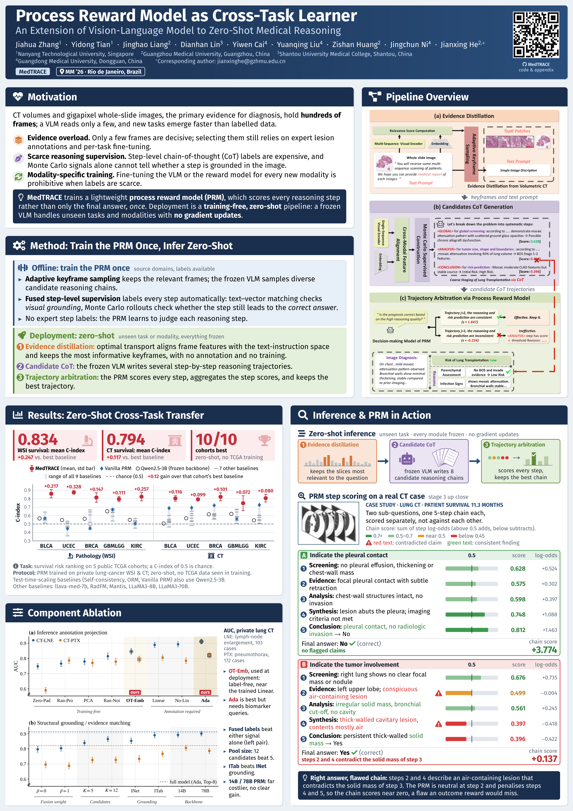

<p align="center">
  <a href="paper/poster.pdf"></a>
</p>
<p align="center">Poster (PDF): <a href="paper/poster.pdf"><code>paper/poster.pdf</code></a></p>

# MedTRACE

## Overview

MedTRACE trains a lightweight process reward model (PRM) once and then reasons over long medical image series with a frozen vision-language model, zero-shot and without gradient updates at deployment:
1. **Evidence distillation:** optimal transport aligns frame features with the text-instruction space and keeps the most informative keyframes, with no annotation and no training.
2. **Candidate CoT:** the frozen VLM writes several step-by-step reasoning trajectories over the kept frames.
3. **Trajectory arbitration:** the PRM scores every step, aggregates the step scores and keeps the best trajectory.

Binary classification and survival staging (C-index) tasks are supported.

## Getting started

Seeds and prompt texts are not in the code: fill [`env/medtrace.env.json`](env/medtrace.env.json) (one per task) and
`export MEDTRACE_ENV=env/medtrace.env.json`.

### Datasets

A dataset is one manifest JSON, e.g. `data/binary/manifest.json`, listing each patient's PNG slice folder and split:

```json
{"task_type": "binary", "modality": "chest CT",
 "patients": [{"pid": "case_0001", "split": "train", "frames_dir": "case_0001", "label": 1}]}
```

Survival manifests use `survival_time` and `event` instead of `label`. `pid` must be a pseudonymous case code.

### Running

Run from the repository root with `M=data/<binary|survival>/manifest.json`, `TASK=binary|survival` and one feature
cache per dataset (`export MEDTRACE_CACHE_ROOT=cache/$TASK`).

```bash
# 1. feature caches
python -m medtrace.features.extract_vlm --model Qwen2.5-VL-3B-Instruct --manifest $M --splits train,test --device cuda:0
python -m medtrace.features.extract_clip --model BiomedCLIP-PubMedBERT_256-vit_base_patch16_224 --manifest $M

# 2. PRM training on the train split, one pool per seeds.pool entry
#    <pool i> = runs/train_pool_$TASK/<gen tag>/ada/seed<S_i>
bash scripts/run_serve.sh configs/train/pool.yaml start && bash scripts/run_serve.sh configs/train/pool.yaml wait
for i in 0 1; do
  python -m medtrace distill  --config configs/train/pool.yaml --set manifest=$M exp=train_pool_$TASK seed_index=$i
  python -m medtrace generate --config configs/train/pool.yaml --set manifest=$M exp=train_pool_$TASK seed_index=$i
done
python -m medtrace.train split --manifest $M --n-meta <n held-out patients> --out runs/train/$TASK/split.json
for i in 0 1; do
  python -m medtrace.train mc --run-dir <pool i> --manifest $M --out runs/train/$TASK/mc/pool$i
done
bash scripts/run_serve.sh configs/train/pool.yaml stop
python -m medtrace.train targets --pools <pool 0> <pool 1> --mc runs/train/$TASK/mc/pool0 runs/train/$TASK/mc/pool1 \
    --split-json runs/train/$TASK/split.json --manifest $M --beta 0.5 --out runs/train/$TASK/targets
python -m medtrace.train fit --rows runs/train/$TASK/targets/rows.jsonl --manifest $M \
    --out-name medtrace_prm_$TASK --lr 5e-7 --device cuda:0

# 3. zero-shot inference on the test split (configs/survival.yaml likewise)
bash scripts/run_serve.sh configs/binary.yaml start && bash scripts/run_serve.sh configs/binary.yaml wait
python -m medtrace distill  --config configs/binary.yaml --set seed_index=0
python -m medtrace generate --config configs/binary.yaml --set seed_index=0
bash scripts/run_serve.sh configs/binary.yaml stop
python -m medtrace score    --config configs/binary.yaml --set seed_index=0 prm.weights=medtrace_prm_binary --gpu 0
python -m medtrace report   --config configs/binary.yaml --set seed_index=0 prm.weights=medtrace_prm_binary
```

The report is written to `runs/<exp>/<gen tag>/<variant>/seed<S>/report/<prm>/`. CPU unit checks:
`python -m pytest -q tests`.

## Dependencies
This work is built on [DreamPRM](https://github.com/coder-qicao/DreamPRM). We follow its multimodal PRM formulation.
**Environment.** The reference environment is [`env_vllm.txt`](env_vllm.txt). The generator is served by vLLM from a separate environment (`MEDTRACE_VLLM_PYTHON` or `MEDTRACE_VLLM_CONDA_ENV`, see `scripts/serve_vllm.sh`). Models go under `models/`: a Qwen-VL generator (`Qwen2.5-VL-3B-Instruct`), the PRM backbone `InternVL3-1B` and, for PRM training only `BiomedCLIP-PubMedBERT_256-vit_base_patch16_224`.

## Data prerequisite and availability

MedTRACE assumes that every large image (CT volume, whole-slide image or MRI series) has already been cut into slices or tiles and stored as **one folder of PNG slices per patient**. This slicing and PNG conversion was done by the second authors with standard pipeline, and is not part of this repository.

Pursuant to data governance policies and hospital ethics board mandates, all primary images, sliced data, and private patient cohorts are under strict regulatory protection. Consequently, the raw datasets and comprehensive experimental methodologies are not publicly disclosable. Requests for verified data access for legitimate clinical research purposes should be addressed to the corresponding author Jianxing He (<jianxinghe@gzhmu.edu.cn>).

## Citation
```bibtex
@inproceedings{zhang2026medtrace,
  author    = {Zhang, Jiahua and Tian, Yidong and Liang, Jinghao and Lin, Dianhan and Cai, Yiwen and Liu, Yuanqing and Huang, Zishan and Ni, Jingchun and He, Jianxing},
  title     = {Process Reward Model as Cross-Task Learner. An Extension of Vision-Language Model to Zero-Shot Medical Reasoning},
  booktitle = {Proceedings of the 34th ACM International Conference on Multimedia},
  series    = {MM '26},
  year      = {2026},
  location  = {Rio de Janeiro, Brazil},
  publisher = {Association for Computing Machinery},
  address   = {New York, NY, USA},
  isbn      = {979-8-4007-2213-4},
  doi       = {10.1145/3767308.3835873},
  url       = {https://doi.org/10.1145/3767308.3835873}
}
```
